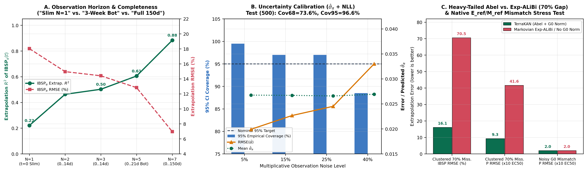

# abelkan

[](https://pypi.org/project/abelkan/)
[](https://opensource.org/licenses/MIT)
[](https://www.python.org/downloads/)
[](https://github.com/Lolycut/abelkan/actions/workflows/ci.yml)

**Drop-in PyTorch primitives for non-Markovian power-law attention, algebraically pole-free Mittag-Leffler spectral bases, and neuro-symbolic power-law discovery — built for irregular time series, FDE/PINN solvers, and long-horizon SciML.**

Extracted from the [TerraKAN (`Frac-ML-KAT-MoE`)](https://github.com/Lolycut/TerraKAN) project by **Ilya Kakhno** ([ORCID: 0009-0005-5503-3269](https://orcid.org/0009-0005-5503-3269)).

---

## Why `abelkan`?

- **Pole-Free `[3/4]` Padé Mittag-Leffler Basis (`MittagLefflerPade34`):** Computes $E_{\alpha, 1}(-z)$ globally on $z \in [0, +\infty)$ with exact autograd across $\alpha = 0.50$ via Euler's reflection identity, $C^1$ smoothstep bridging on $(0.90, 1.0]$, and an **algebraic Descartes certificate** ($q_1, q_2, q_3, q_4 > 0 \implies$ zero positive real poles on $[0, +\infty)$).
- **Heavy-Tailed Abel Attention (`AbelCausalAttention`):** Modulates causal self-attention logits with $-\operatorname{softplus}(\gamma)(1-\hat{\alpha}_i)\ln(\varepsilon + \Delta t_{ij})$, preventing the catastrophic collapse suffered by Markovian exponential decay (`Exp-ALiBi`: $R^2 = -10.93$ vs. `+0.377` for Abel under $70\%$ clustered missingness).
- **Symbolic Power-Law Discovery (`LogExpMultKAN` & `MittagLefflerSpectralHead`):** Recovers multiplicative power laws $x_0^{p_0} x_1^{p_1} \dots$ with $L_1$ sparsity pruning and `.to_symbolic()` export.
- **Sparse Biokinetic Routing (`TemperatureTopKMoE`):** Temperature-annealed Top-$k$ Mixture-of-Experts with load-balancing regularization.



## Installation

```bash
pip install abelkan
```

For development and running unit tests:

```bash
git clone https://github.com/Lolycut/abelkan.git
cd abelkan
pip install -e ".[dev]"
pytest -v
```

## Quickstart

```python
import torch
from abelkan import (
    AbelTransformerLayer,
    LogExpMultKAN,
    MittagLefflerPade34,
    MittagLefflerSpectralHead,
)

# 1. Pole-free Mittag-Leffler basis & Caputo derivative
ml = MittagLefflerPade34()
print(ml.certify_pole_free())  # {'certified_pole_free': True, ...}
t = torch.linspace(0.0, 100.0, 50, dtype=torch.float64)
y, dy_dt_alpha = ml.caputo_basis_and_derivative(lam=torch.tensor(0.05), t=t, alpha=torch.tensor(0.75))

# 2. Irregular time-series encoding with Abel power-law attention
layer = AbelTransformerLayer(d_model=48, decay_mode="abel")
x = torch.randn(4, 8, 48)
timestamps = torch.tensor([[0., 3., 7., 14., 21., 45., 90., 120.]] * 4)
h, alpha_hat, sigma_alpha = layer(x, timestamps)

# 3. Multi-channel Mittag-Leffler trajectory decoding
head = MittagLefflerSpectralHead(d_model=48, out_channels=3, num_modes=3)
traj = head(h[:, -1], alpha_hat[:, -1], t)  # (4, 50, 3)
```

## Citation

If you use `abelkan` in your research, please cite:

```bibtex
@misc{kakhno2026terrakan,
  author       = {Kakhno, Ilya},
  title        = {TerraKAN: Fractional Kolmogorov-Arnold Transformer with Pad\'e Mittag-Leffler Basis and Biokinetic Mixture-of-Experts},
  year         = {2026},
  howpublished = {\url{https://github.com/Lolycut/TerraKAN}},
  note         = {ORCID: 0009-0005-5503-3269}
}
```
